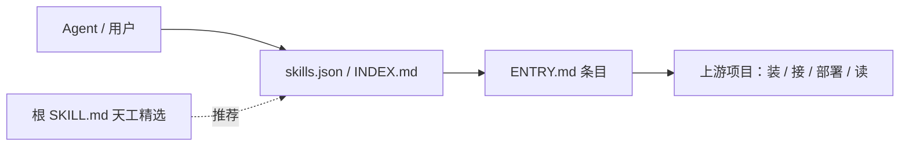

<div align="center">

# AstraCraft Program 天工计划

**面向中文用户的 AI 开源项目索引与推荐技能。**

一个轻量、中文为主的 AI 开源项目索引：每个条目只存一份 `ENTRY.md`（介绍 + 上手指令），
按「装进 Agent / 接入 Agent / 部署运行 / 阅读参考」四种消费方式组织。不收录上游源码快照。

[](site/index.html)
[](LICENSE)
[](LICENSE)
[](https://github.com/AvalonLee/AstraCraft-Program/actions/workflows/index-check.yml)
[](https://github.com/AvalonLee/AstraCraft-Program/actions/workflows/link-check.yml)

</div>

---

## 快速入口

- **在线预览**：[avalonlee.github.io/AstraCraft-Program](https://avalonlee.github.io/AstraCraft-Program/) —— 搜索 / 分类 / 消费方式筛选 / 点开看每个项目的上手命令
- **机器读取**：[site/data/skills.json](https://avalonlee.github.io/AstraCraft-Program/data/skills.json) —— 全量条目元数据，`schema_version: 1`，harness 可直接索引
- **推荐收录**：[建议收录新条目](https://github.com/AvalonLee/AstraCraft-Program/issues/new?template=new-entry.yml) —— 发现优质 AI 开源项目？一键提交
- 更新日志：[docs/CHANGELOG.md](docs/CHANGELOG.md)

## 一句话装到你的 Agent

不想翻库、不想手敲？把下面这句直接发给你的 AI Agent，它会只安装「天工精选」这**一份**技能（仓库根目录的 `SKILL.md` 单文件），不会把库里的条目注册成技能：

```
请安装天工计划的天工精选技能（AstraCraft Recommender，只装根目录 SKILL.md 这一份）：https://github.com/AvalonLee/AstraCraft-Program
```

> 天工精选是本计划的配套推荐技能：装好后，描述你的项目实况，它从库里挑出最该装的技能或项目，并给出上手路径。
> 推荐时**先联网核对上游最新状态**（归档、最近推送、许可证），网络不可用时回退本地数据并明确提示。
> 技能本体即仓库根目录 [SKILL.md](SKILL.md)；库数据是 `entries/` 下的 `ENTRY.md`，不是可安装技能。

## 两种文件，一条边界

| 文件 | 声明 | 谁读 | 可安装？ |
|---|---|---|---|
| 根目录 `SKILL.md` | `record_type: installable-skill` | Agent 技能扫描 | **是**，全库唯一 |
| `entries/**/ENTRY.md` | `record_type: entry-record` | 推荐器 / harness / 人 | 否，只是条目数据 |



改名成 `ENTRY.md` 是刻意的：多数 Agent 按文件名发现技能，扫到 `SKILL.md` 就会注册。条目不是技能，不该出现在技能列表里。

详见 [目录条目格式](docs/catalog-format.md) 与 [可安装技能格式](docs/installable-skill-format.md)。

## 四种消费方式

| `mode` | 含义 | 条目里的小节 | 典型例子 |
|---|---|---|---|
| `install` | 装进 Agent 的技能目录 | 怎么安装 | skill、技能集 |
| `connect` | 作为 MCP / CLI / API / SDK 被调用 | 怎么接入 | browser-use、CLI 工具 |
| `deploy` | 自己跑起来（桌面端、服务、工作台） | 怎么部署运行 | 自托管平台、剪辑工具 |
| `read` | 阅读规范、提示词库、资源集 | 怎么阅读 | 规范、awesome 集 |

一个项目只取一个主模式，判定顺序 **install > deploy > connect > read**：先看能不能直接装成技能，再看是不是要自己跑的成品，最后才看是不是被调用的工具。

## 每个 ENTRY.md 里有什么

| # | 部分 | 说明 |
|---|---|---|
| 1 | frontmatter 元数据 | id / 名称 / 摘要 / 分类 / 消费方式 / 标签 / 协议 / 评级 |
| 2 | 这是什么 | 它是什么、由谁维护、处于什么生态位 |
| 3 | 怎么上手 | 按 mode 四选一的小节，内含可执行命令 |
| 4 | 怎么用 | 起步用法 |
| 5 | 注意事项 | 已知限制、依赖、维护状态、许可证是否可商用 |

frontmatter 关键字段：

| 字段 | 含义 |
|---|---|
| `id` | 全局唯一标识，必须等于所在目录名 |
| `name_zh` / `name_en` | 中文 / 英文名称 |
| `summary_zh` | 它解决什么问题、适合谁用（≤200 字） |
| `category` | 一级分类之一（见下「收录内容」） |
| `mode` | 消费方式：`install` / `connect` / `deploy` / `read` |
| `tags` | 便于检索的标签 |
| `license` | SPDX 标识符或 UNKNOWN，供判断是否可商用 |
| `repo` / `homepage` | 上游仓库与主页链接 |
| `tier` | 评级：`core` 主推 / `standard` 常规 / `watch` 观察 |

## 如何使用

**Agent / harness（推荐）：** 拉一份 [skills.json](https://avalonlee.github.io/AstraCraft-Program/data/skills.json)，按 `category` / `mode` / `tags` / `license` 筛选；需要完整说明时再取 `source_url`。推荐只使用 `verification_status: verified` 且非观察期（`tier` ≠ `watch`）的条目。

**人工浏览：** 打开 [在线预览站](https://avalonlee.github.io/AstraCraft-Program/)，用搜索、分类、消费方式、标签、评级、协议筛选。

**离线 / 仓库内：** 读 [INDEX.md](INDEX.md) 的七个视图，或直接翻 `entries/`；每个目录里的 `ENTRY.md` 就是完整条目。

**写自己的 skill：** 参考 [技能规范速查](docs/skill-spec-cheatsheet.md)（对齐 Agent Skills 规范）与 [可安装技能格式](docs/installable-skill-format.md)。

## 这个中文版本额外做了什么？

- **在线预览站**：搜索 + 分类 / 消费方式 / 标签 / 评级 / 协议筛选，点开即看上手命令
- **机器契约**：`site/data/skills.json` 带 `schema_version`、`mode`、核验状态与上手命令，harness 无需克隆仓库
- **中文导读与索引**：`INDEX.md` 七视图交叉索引，附英文摘要
- **CI 保障**：`index-check` 校验条目完整性，`link-check` 定期扫死链，`upstream-refresh` 每周核验上游

## 收录内容

当前收录 **96** 个条目，按 8 个分类组织（目录名 → 定位）：

| 目录 | 定位 |
|---|---|
| `entries/writing-docs/` | 文案、报告、技术写作、文档生成 |
| `entries/dev-engineering/` | 编码、重构、测试、代码审查 |
| `entries/design-creative/` | UI/UX、视觉、品牌、素材生成 |
| `entries/research-intel/` | 检索、调研、信息聚合、竞品分析 |
| `entries/ops-automation/` | 自托管服务、部署、CI/CD、脚本、系统维护 |
| `entries/business-office/` | 办公文档、协作、流程、商务 |
| `entries/agent-infra/` | MCP server、框架、CLI、运行时与 DSH 插件 |
| `entries/meta-skillcraft/` | 写 skill 的 skill、规范、模板、元技能 |

完整条目列表与交叉检索见 **[INDEX.md](INDEX.md)**。

## 收录标准（摘要）

完整门槛见 [docs/admission-criteria.md](docs/admission-criteria.md)：

- **A1 可获取** —— 项目公开可达，`repo` / `homepage` 是有效链接
- **A2 文档可用** —— 有能让人上手的说明（README 或等价文档）
- **A3 上手可循** —— 按 `mode` 能写出一条明确指令：安装 / 接入 / 部署 / 阅读
- **A4 协议标注** —— frontmatter 填 `license`（SPDX 或 UNKNOWN），供判断是否可商用

**不收：** 模型权重、数据集、纯训练算法库、无使用路径的论文 / benchmark 仓库。闭源或需付费才能使用的项目由 A1 排除。

**评级三档：** `core`（主推）/ `standard`（常规）/ `watch`（观察期）。

> 本仓库**不收录源码**，协议只作参考标注；能否商用一律以上游 LICENSE 全文为准。

## 贡献新条目

欢迎 PR！完整流程见 [docs/CONTRIBUTING.md](docs/CONTRIBUTING.md)。要点（三步）：

1. 参照 [目录条目格式规范](docs/catalog-format.md) 创建 `entries/<分类>/<id>/ENTRY.md`；
2. 填 frontmatter（`id` 等于目录名，`mode` 四选一），正文写「是什么 / 怎么上手 / 怎么用 / 注意事项」；
3. 跑 `python scripts/validate.py && python scripts/gen_index.py && python scripts/gen_site.py`，提交 PR
   （重新生成的 `INDEX.md` 与 `site/data/skills.json` 要一并提交；详情页 `site/skills/` 由部署工作流生成，不入库）。

本地预览站点：跑 `python scripts/gen_site.py` 后执行 `python -m http.server -d site`，浏览器开 `http://localhost:8000`。

## 协议与合规

- **本仓库的原创内容**（分类体系、导读、脚本、文档）：
  - 文档类 → **CC BY 4.0**（见 [LICENSE](LICENSE)）
  - 代码类（`scripts/`、`*.yml` 工作流）→ **MIT**（见 [LICENSE](LICENSE)）
- **收录条目的内容**：著作权归各自作者，本仓库仅提供导航与说明，不含上游源码。

## 下架与联系

如果你是某项内容的著作权人，希望本仓库移除相关收录：

- 开 Issue：https://github.com/AvalonLee/AstraCraft-Program/issues
- 或发邮件至：avalonli@qq.com

**承诺 7 日内处理，无需提供任何法律文书**，一句话说明身份和诉求即可。
我们会删除相关内容并在 docs/CHANGELOG.md 中记录。

---

<p align="center">
  <sub>AstraCraft Program 天工计划 · 轻量索引 · 只存 ENTRY.md · 中文为主 · 可溯源</sub>
</p>
